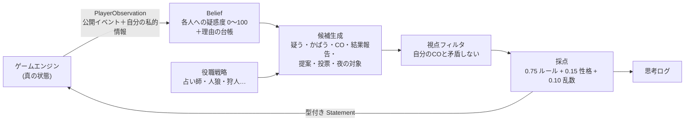

# Werewolf Strategy Engine

[English](README.md) | **日本語**

> LLMを使わないルールベースの人狼AIエンジン。推理・戦術・大量シミュレーション・実験のために。


[](https://github.com/atenisoc/werewolf-strategy-engine/actions/workflows/ci.yml)
[](LICENSE)


**▶ ブラウザで遊ぶ: <https://kayaigoing.org/hitori-jinro/>** （5〜15人村に参加または観戦。終了後「AI思考を見る」で全員の推理が読めます）

## これは何か

TypeScript で書いた人狼ゲームのエンジンで、全プレイヤーが**ルールベースAI**です。各AIは他の全員に 0〜100 の疑惑度を持ち、公開情報から約40本の（効果を実測した）推理ルールで更新し、型付きの発言候補から言うことを選び、自分が名乗った役職（本物でも騙りでも）と矛盾しない行動を取ります。言語モデル・APIキー・通信は使いません。13人村1試合が約10ms、同じ seed で各AIの内部ログまで完全に再現できます。

もとは一人用ゲーム「ひとり人狼」として作ったものですが、AIのルールはすべて数千試合の自己対戦で採否を決めてきたため、「人狼の戦術を試す実験装置」に近いものになりました。公開する理由もそこにあります。**誰かがもっと強い戦術を書き、同じ seed で既存AIと比べ、その結果を戻してくれること**を期待しています。

## 特徴（すべて実装・計測済み）

- **構造で守る情報分離。** AIが受け取るのは `PlayerObservation`（公開ログ＋自分の役職の私的情報）だけで、真の状態には触れません。他人の役職を入れ替えても観測が変わらないことをテストで検証しています。
- **説明できる判断。** 疑惑度の変化はすべて理由付きの台帳に残り、各行動は候補ごとのルール／性格／乱数の内訳とともに記録されます。ブラウザ版では試合後にそのまま読めます。
- **視点の整合性。** 占い師を騙る人狼も、自分の偽の白をかばい、偽の黒を吊りに行き、自分を含むローラーは提案しません。
- **人狼の連携。** 初夜の作戦会議（騙り役・囲い・身内切り）、襲撃先の合議、人狼専用チャネル、占いCOの判定を真実と照合する真偽判定。
- **8役職・5編成。** 村人・占い師・霊能者・狩人・共有者・人狼・狂人・妖狐。5／7／9／13／15人村に人数別の均衡パラメータ。
- **決定的なシミュレーション。** 用途別の乱数列、ログは乱数を消費しない。13人村2000試合が22秒、異常0・情報漏洩0。
- **計測機能を内蔵。** 陣営勝率、投票精度、順位精度(AUC)、ルール別正解率、疑惑度の推移、性格別・バリアント別の成績、会話の不自然さ監査、人数別にルールの効き具合を較正するロジスティック回帰。
- **戦術の差し替え。** `AgentVariant` を登録して `node dist/sim.js --compare my-variant` と打てば、同じ seed 群で既存AIと対戦し、差と信頼区間が出ます。

## 仕組み



詳しくは [architecture](docs/architecture.md) → [reasoning](docs/reasoning.md) → [strategy](docs/strategy.md) → [role-strategies](docs/role-strategies.md)（英語）。

<p align="center">


</p>

## 他の人狼AIとの違い

| | このエンジン | LLM型エージェント | AIWolf系プロトコルエージェント |
|---|---|---|---|
| 推理 | 明示的なルール＋実測した重み | プロンプト依存・暗黙 | さまざま（ルールベースが多い） |
| 1試合のコスト | 約10ms・API不要 | 秒〜分・API料金 | 速い |
| 再現性 | seed でビット単位に一致 | ほぼ不可 | 多くは可 |
| 説明 | 全増減に理由 | 事後の文章 | さまざま |
| 自然言語 | 出力のみ（日本語テンプレ・方言） | 入出力 | プロトコルのみ |
| 騙り・視点整合・人狼の連携 | あり・計測済み | モデル次第 | エージェント次第 |

まだできていない比較は「人間に対する強さ」です（[limitations](docs/limitations.md)）。

## ベンチマーク（自己対戦・各2000試合）

| 人数 | 村側 | 人狼側 | 妖狐 | 投票精度 | 順位精度 | 時間 |
|---:|---:|---:|---:|---:|---:|---:|
| 5 | 55.5% | 44.5% | – | 62.9% | 77.2% | 3.7秒 |
| 7 | 53.1% | 46.9% | – | 73.7% | 78.0% | 7.6秒 |
| 9 | 54.5% | 45.5% | – | 46.0% | 67.2% | 9.6秒 |
| 13 | 46.9% | 53.0% | – | 45.4% | 67.0% | 21.8秒 |
| 15 | 40.4% | 41.9% | 17.8% | 35.3% | 69.8% | 44.3秒 |

seed 7001〜9000、Node 22、1コア。全表・ルール別正解率・数字の限界は [docs/benchmark.md](docs/benchmark.md)。

## クイックスタート

```bash
git clone https://github.com/atenisoc/werewolf-strategy-engine.git
cd werewolf-strategy-engine
npm install            # 開発依存のみ: esbuild, typescript
npm run build          # dist/index.html（ゲーム）と dist/sim.js（CLI）
npm test               # 22件

node dist/sim.js --n 13 --games 1000              # 大量対戦（勝率・精度）
node dist/sim.js --n 9 --replay 42 --think        # 1試合を全AIの思考付きで表示
node dist/sim.js --n 13 --games 2000 --rules      # ルール別の正解率
node dist/sim.js --help                           # 全オプション
# dist/index.html をブラウザで開けば遊べます（サーバー不要）
```

## 自分の戦術を書いて比べる

```ts
// src/agents/variants/my-variant.ts
export const myVariant: AgentVariant = {
  name: 'my-variant',
  description: '占い師の白を信じにくい村',
  create: (o) => new RuleAgent({ ...o, behavior: { ...o.behavior, w: { seerWhite: 30 } }, strategies: { villager: myVillager } }),
};
```

```bash
node dist/sim.js --compare my-variant --n 13 --games 2000   # 同じseedで 既存AI vs 自分のAI
node dist/sim.js --vs my-variant --n 13 --games 2000        # 同じ村に混ぜて席ごとに比較
```

同梱の [`example-skeptic`](src/agents/variants/example-skeptic.ts) が、重みの上書きと役職戦略の差し替えの両方を40行で示しています。手順は [docs/extension-guide.md](docs/extension-guide.md)。

## ドキュメント

| | |
|---|---|
| [architecture.md](docs/architecture.md) | モジュール構成・進行・AIの処理の流れ（図あり） |
| [game-rules.md](docs/game-rules.md) | エンジンが実装しているルール |
| [reasoning.md](docs/reasoning.md) | 疑惑度モデル・推理ルール・学習倍率・思考ログの読み方 |
| [strategy.md](docs/strategy.md) | なぜこの戦術か：計測・ミニマックス・均衡探索 |
| [role-strategies.md](docs/role-strategies.md) | 役職ごとの行動と、元になった定石 |
| [extension-guide.md](docs/extension-guide.md) | 戦術の追加・比較・PRの出し方 |
| [benchmark.md](docs/benchmark.md) | 現行版の数値と再現コマンド |
| [limitations.md](docs/limitations.md) | できないこと |
| [roadmap.md](docs/roadmap.md) | 手伝ってほしいこと |
| [glossary.md](docs/glossary.md) | 人狼用語の英訳 |

コードのコメントは日本語です。英語の資料から該当箇所へリンクしています。[AGENTS.md](AGENTS.md) は AI コーディング支援（Copilot / Cursor / Claude Code / Codex）向けの1ページ地図です。

## 貢献

バリアント、ルールの提案、計測ツール、翻訳、「効かなかった」という結果も歓迎です。[CONTRIBUTING.md](CONTRIBUTING.md) を参照してください。挙動に関わる変更には `--compare` の出力を添えてください。

## ライセンス

コードは [MIT](LICENSE)。`assets/` の立ち絵・背景・挿絵はこのプロジェクトのために生成AIで作成した画像で、そのままビルドできるよう同梱しています（条件は [LICENSE](LICENSE)）。

## 謝辞

エンジンとエージェントの分離、観測の分離、信念→方針→決定の3段構成は [RLereWolf](https://github.com/GeorgeVelikov/RLereWolf)、[werewolf-agent](https://github.com/satter0827/werewolf-agent)、[KylJin/Werewolf](https://github.com/KylJin/Werewolf) を読んで設計の参考にしました（コードの流用はありません）。実装した定石は日本の人狼コミュニティに蓄積された理論によるものです。
