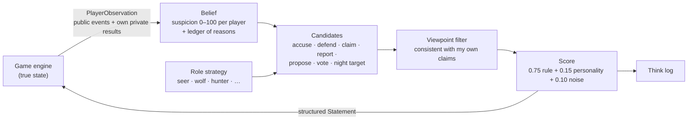

# Werewolf Strategy Engine

**English** | [日本語](README.ja.md)

> An open-source, rule-based AI engine for Werewolf — built for reasoning, strategy, simulation, and experimentation.


[](https://github.com/atenisoc/werewolf-strategy-engine/actions/workflows/ci.yml)
[](LICENSE)


**▶ Play it in your browser: <https://kayaigoing.org/hitori-jinro/>** (Japanese UI; take a seat or spectate 5–15 AI players, then open "AI思考" to read every agent's reasoning).

## What this is

A complete Werewolf (Mafia) engine in TypeScript where every player is a **rule-based agent**: it keeps a 0–100 suspicion score for everyone else, updates it from public events through about forty hand-written and measured rules, chooses what to say from a structured set of statements, and stays consistent with whatever role it has claimed — truthfully or not. No language model, no API key, no network. A 13-player game takes about 10 ms; one `seed` reproduces the whole game including every agent's internal log.

It started as a single-player game ("ひとり人狼", *Werewolf alone*) and grew into something closer to a strategy laboratory: every rule the AI uses was accepted or rejected by thousands of self-play games, and the tooling for doing that is in the repository. Which is the point of publishing it — **we would like other people to write better strategies, measure them against ours on the same seeds, and send them back.**

## Features (all implemented, all measured)

- **Information barrier by construction.** Agents receive a `PlayerObservation` (public log + their own private results), never the game state. A test swaps other players' roles and asserts the observation is unchanged.
- **Explainable decisions.** Every suspicion change has a ledger entry with a reason; every action logs its top candidates with rule / personality / noise contributions. The browser game shows this to the player after the game.
- **Viewpoint consistency.** A fake seer defends its fake whites and pushes its fake blacks exactly like a real one; a claimant never proposes a roller that includes itself.
- **Werewolf coordination.** Night-0 planning (who fakes a claim, fencing, cutting a doomed mate), joint bite decisions, a private wolf channel, truth-checking of seer claims against what the wolves know.
- **8 roles, 5 presets.** Villager, seer, medium, hunter, mason, werewolf, madman, fox; 5 / 7 / 9 / 13 / 15 players with per-size balance knobs.
- **Deterministic simulation.** Named RNG streams per purpose; logging never consumes randomness. 2 000 games of 13 players in 22 s, 0 anomalies, 0 leaks.
- **Measurement built in.** Win rates, vote accuracy, ranking AUC, per-rule hit rates, suspicion trajectories, per-personality and per-variant stats, a naturalness audit of the conversation, and an offline logistic-regression step that calibrates rule magnitudes per player count.
- **Pluggable strategies.** Register an `AgentVariant`, then `node dist/sim.js --compare my-variant` runs the same seeds against the baseline and prints the difference with a confidence interval.

## How it works



A deeper tour: [architecture](docs/architecture.md) → [reasoning](docs/reasoning.md) → [strategy design](docs/strategy.md) → [role strategies](docs/role-strategies.md).

<p align="center">


</p>

## How it differs from other Werewolf AIs

| | This engine | LLM-based agents | AIWolf-style protocol agents |
|---|---|---|---|
| Reasoning | explicit rules with measured weights | prompt-driven, implicit | varies (often rule-based) |
| Cost per game | ~10 ms, no API | seconds to minutes, API fees | fast |
| Reproducible | yes, by seed, bit-exact | rarely | usually |
| Explains itself | every delta has a reason | post-hoc text | varies |
| Natural language | output only (Japanese templates, dialects) | in and out | protocol, no NL |
| Fake-claim play, viewpoint consistency, wolf coordination | yes, measured | depends on the model | depends on the agent |

The comparison that we *cannot* make yet is strength against humans — see [limitations](docs/limitations.md).

## Benchmark (self-play, 2 000 games per size)

| Players | Village | Werewolf | Fox | Vote accuracy | Rank AUC | Time |
|---:|---:|---:|---:|---:|---:|---:|
| 5 | 55.5% | 44.5% | – | 62.9% | 77.2% | 3.7 s |
| 7 | 53.1% | 46.9% | – | 73.7% | 78.0% | 7.6 s |
| 9 | 54.5% | 45.5% | – | 46.0% | 67.2% | 9.6 s |
| 13 | 46.9% | 53.0% | – | 45.4% | 67.0% | 21.8 s |
| 15 | 40.4% | 41.9% | 17.8% | 35.3% | 69.8% | 44.3 s |

Seeds 7001–9000, Node 22, one core. Full tables, per-rule accuracy and what the numbers do *not* mean: [docs/benchmark.md](docs/benchmark.md).

## Quick start

```bash
git clone https://github.com/atenisoc/werewolf-strategy-engine.git
cd werewolf-strategy-engine
npm install            # dev deps only: esbuild, typescript
npm run build          # dist/index.html (game) + dist/sim.js (CLI)
npm test               # 22 tests

node dist/sim.js --n 13 --games 1000              # batch, with win rates and accuracy
node dist/sim.js --n 9 --replay 42 --think        # one game with every agent's reasoning
node dist/sim.js --n 13 --games 2000 --rules      # per-rule hit rates
node dist/sim.js --help                           # all options
open dist/index.html                              # play (no server needed)
```

## Write your own strategy and compare it

```ts
// src/agents/variants/my-variant.ts
export const myVariant: AgentVariant = {
  name: 'my-variant',
  description: 'trusts seer whites less',
  create: (o) => new RuleAgent({ ...o, behavior: { ...o.behavior, w: { seerWhite: 30 } }, strategies: { villager: myVillager } }),
};
```

```bash
node dist/sim.js --compare my-variant --n 13 --games 2000   # same seeds: baseline vs yours
node dist/sim.js --vs my-variant --n 13 --games 2000        # both in the same village, per-seat results
```

The shipped [`example-skeptic`](src/agents/variants/example-skeptic.ts) shows both mechanisms (weight override and role-strategy override) in 40 lines. Step-by-step: [docs/extension-guide.md](docs/extension-guide.md).

## Documentation

| | |
|---|---|
| [architecture.md](docs/architecture.md) | modules, game loop, agent pipeline, diagrams |
| [game-rules.md](docs/game-rules.md) | the exact rules the engine plays |
| [reasoning.md](docs/reasoning.md) | the suspicion model, the rules, learned scales, reading a think log |
| [strategy.md](docs/strategy.md) | why the AI plays this way: measurement, minimax, equilibrium search |
| [role-strategies.md](docs/role-strategies.md) | what each role does and which convention it comes from |
| [extension-guide.md](docs/extension-guide.md) | add a strategy, compare it, submit it |
| [benchmark.md](docs/benchmark.md) | current numbers and how to reproduce them |
| [limitations.md](docs/limitations.md) | what it cannot do |
| [roadmap.md](docs/roadmap.md) | where help is wanted |
| [glossary.md](docs/glossary.md) | Japanese Werewolf jargon → English |

Code comments are in Japanese; the docs above link into the source and the glossary covers the vocabulary. [AGENTS.md](AGENTS.md) is a one-page map for AI coding assistants (Copilot, Cursor, Claude Code, Codex).

## Contributing

Variants, rule proposals, measurement tooling, translations and negative results are all welcome — see [CONTRIBUTING.md](CONTRIBUTING.md). Issues tagged `good first issue` are sized for a first PR. Please include `--compare` output for any change that touches behaviour.

## License

Code: [MIT](LICENSE). The character portraits and background illustrations under `assets/` are AI-generated artwork made for this project; they are included so the game builds as-is, see [LICENSE](LICENSE) for their terms.

## Acknowledgements

Design ideas (engine/agent separation, observation isolation, belief → policy → decision staging) were taken from reading [RLereWolf](https://github.com/GeorgeVelikov/RLereWolf), [werewolf-agent](https://github.com/satter0827/werewolf-agent) and [KylJin/Werewolf](https://github.com/KylJin/Werewolf); no code was copied. The Werewolf conventions implemented here come from the Japanese 人狼 community's accumulated theory.
