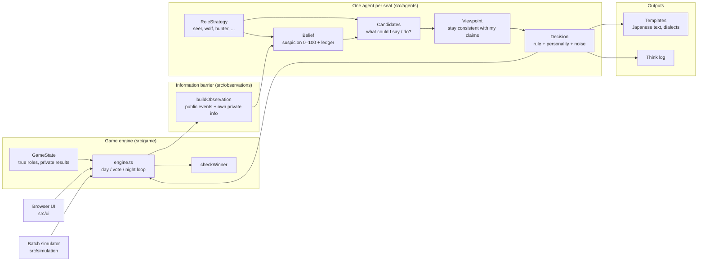
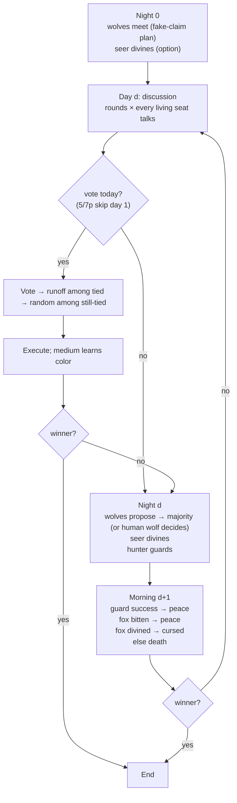
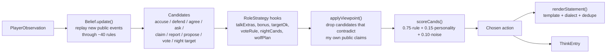

# Architecture

Werewolf Strategy Engine is a rule-based Werewolf (Mafia) engine in TypeScript. It has no runtime dependencies, no LLM calls and no network calls. One `seed` reproduces a whole game, including every agent's internal reasoning log.

This document describes the actual code structure. File paths are relative to the repository root.

## 1. Big picture

Three ideas carry the design:

1. **Information barrier.** `GameState` holds the truth. An agent only ever receives a `PlayerObservation` — the public event log plus the private results of its own role. The only place that reads a true role to build an observation is `buildObservation()` in [`src/observations/observation.ts`](../src/observations/observation.ts), and it reads *only the observer's own role*. A test swaps other players' roles and asserts that the observation does not change ([`tests/tests.ts`](../tests/tests.ts), "情報漏洩なし").
2. **Determinism.** Every random choice comes from a named stream derived from the seed (`setup`, `persona`, `game`, `agent:<seat>`, `advisor`, `humanText`), see [`src/util/rng.ts`](../src/util/rng.ts). Logging never consumes randomness, so turning logs on or off cannot change a game.
3. **Explainability.** Suspicion is a plain 0–100 number per player with a ledger of `(label, delta, day)` entries. Every decision records its top candidates with the rule / personality / noise contributions ([`src/logs/think.ts`](../src/logs/think.ts)).

## 2. Modules

| Directory | Responsibility | Key files |
|---|---|---|
| `src/game` | Rules, state, progression, win check | `types.ts` (all shared types), `roles.ts` (role table: camp, counts-as-wolf, seer color, night action), `config.ts` (presets for 5/7/9/13/15 players, behaviour defaults), `engine.ts` (the generator-based game loop), `session.ts` (human-in-the-loop wrapper), `run.ts` (AI-only game) |
| `src/observations` | What a seat is allowed to know | `observation.ts` |
| `src/agents` | The AI | `agent.ts` (RuleAgent), `belief.ts` (suspicion model), `candidates.ts` (speech/vote candidates), `viewpoint.ts` (claim consistency), `decision.ts` (scoring), `personality.ts`, `flags.ts` (rule switches and tunables), `rulekey.ts`, `rule-scale.gen.ts` (learned per-rule multipliers), `roles/*.ts` (per-role strategies), `variants/` (pluggable agent variants for experiments) |
| `src/actions` | Statement schema, validation and Japanese rendering | `statement.ts`, `templates.ts`, `dialect.ts` |
| `src/logs` | Think log formatting and replay codes | `think.ts`, `replay.ts` |
| `src/simulation` | Batch runner, CLI, audits | `batch.ts`, `sim-cli.ts`, `audit.ts` (leak and invariant checks), `naturalness.ts` (speech-quality audit), `report.ts` |
| `src/ui` | Single-file browser game | `main.ts`, `index.template.html`, `style.css`, `guide.ts`, `assets.gen.ts` (generated: embedded images) |
| `scripts` | Build, test, benchmark, learning helpers | `build.mjs`, `test.mjs`, `benchmark.mjs`, `audit.mjs`, `tune.mjs`, `equilibrium.sh`, `learn.py` |
| `tests` | One file, 22 tests, run with `npm test` | `tests.ts` |

## 3. Game loop

The engine is a generator (`playGame` in [`src/game/engine.ts`](../src/game/engine.ts)). When a seat is an AI it calls the agent directly; when a seat is human it `yield`s a request and resumes with the answer. The batch simulator and the browser UI drive the same generator.

Win check (`checkWinner`): village wins when no wolf is alive; wolves win when wolves ≥ humans; if either happens while a fox is alive, the fox wins alone.

## 4. Agent pipeline

`RuleAgent` ([`src/agents/agent.ts`](../src/agents/agent.ts)) turns one observation into one action:

- **Belief** ([`src/agents/belief.ts`](../src/agents/belief.ts)) keeps, per other player: suspicion (0–100), a ledger of reasons, seer-claim credibility, role-claim bookkeeping (seer / medium / hunter / mason claims, contradictions), estimated wolves left, fox pressure. Weights live in the `W` table at the top of the file. Each applied delta is multiplied by a learned per-rule, per-player-count scale from `rule-scale.gen.ts` (see [reasoning.md](reasoning.md)).
- **Candidates** ([`src/agents/candidates.ts`](../src/agents/candidates.ts)) generates the things any player could say now, each with a rule score 0–100 and a `Statement` payload. Same-day consistency is enforced here (no accusing someone you defended today).
- **Viewpoint** ([`src/agents/viewpoint.ts`](../src/agents/viewpoint.ts)) applies to anyone who claimed a role, real or fake: never attack your own whites, push your own blacks, treat rival claimants as fake, never propose a roller that includes yourself.
- **Decision** ([`src/agents/decision.ts`](../src/agents/decision.ts)) is a weighted sum; the weights are a config value and a test asserts the 75/15/10 split.
- **RoleStrategy** ([`src/agents/types.ts`](../src/agents/types.ts), implementations in [`src/agents/roles/`](../src/agents/roles/)) is the extension point for role behaviour. A strategy may implement any subset of the hooks; a missing hook falls back to villager behaviour.

## 5. Statements are data

Agents and humans produce a typed `Statement` (`{ kind: 'accuse', target, reason }`, `{ kind: 'co', claim: 'seer' }`, `{ kind: 'result', claim: 'seer', target, color }`, ...) — see `StatementKind` in [`src/game/types.ts`](../src/game/types.ts). The engine validates it ([`src/actions/statement.ts`](../src/actions/statement.ts)) and renders Japanese text from templates. Other agents reason over the structured statement, never over the text, so text generation is cosmetic and could be replaced (or translated) without touching the AI.

## 6. Werewolf coordination

Wolves share a private channel `priv.wolfChat` that only wolf observations contain. On night 0 one wolf proposes a `WolfPlan` (who fakes a seer claim, whether to "fence" a mate with a fake white, whether to vote against a doomed mate). Each night every wolf proposes a target; the engine takes the majority (a human wolf decides directly). The final target is written back to the channel so later fox / guard inference uses the real attack, not each wolf's proposal.

## 7. Human play and replay

[`src/game/session.ts`](../src/game/session.ts) wraps the generator for the UI. A human game is reproducible from `seed + the human's inputs`; [`src/logs/replay.ts`](../src/logs/replay.ts) encodes that as a short replay code, and a test asserts replay equality.

## 8. Batch simulation

[`src/simulation/batch.ts`](../src/simulation/batch.ts) runs N games from consecutive seeds and aggregates: camp win rates, average days, role survival, vote accuracy (share of village-side votes that hit a wolf), ranking AUC (does the village rank wolves above villagers before each vote?), per-rule hit rates, per-personality and per-variant stats, trajectory of suspicion on wolves vs villagers by day. Every game is also checked for invariants (dead players don't act, the game terminates, winner matches the state) and optionally for information leaks.

## 9. What is intentionally *not* here

- No natural-language understanding. Input is structured; text is output only.
- No probabilistic inference over full role assignments. Suspicion is additive and local. This is a deliberate trade-off for explainability and speed (≈1 ms per game-day); see [limitations.md](limitations.md).
- No neural network at runtime. The learned per-rule scales are plain constants generated offline.
